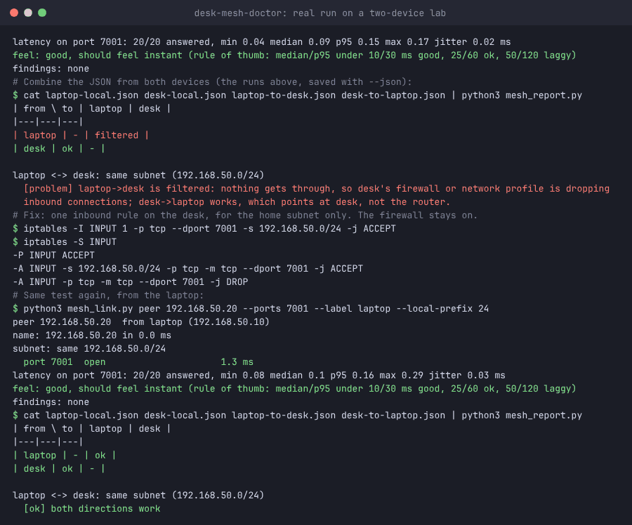
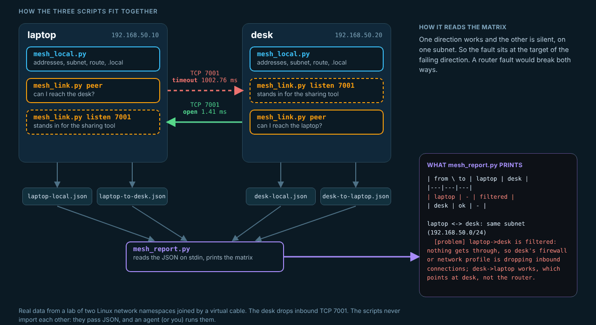
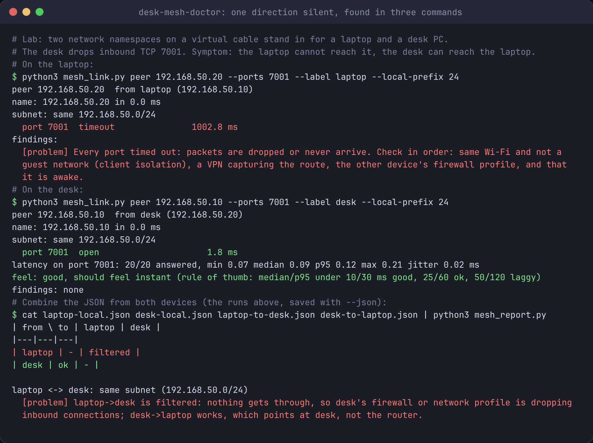
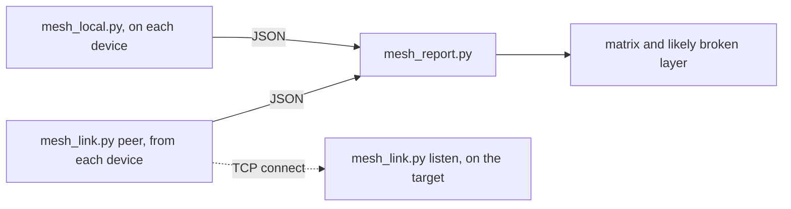

<p align="center"></p>
<h1 align="center">Desk Mesh Doctor</h1>
<p align="center"><b>Find out why your devices will not work as one desk, and fix it.</b></p>
<p align="center">
<a href="https://github.com/FinnTech3/desk-mesh-doctor/actions/workflows/ci.yml"></a>


</p>
<p align="center"></p>

## The straight answer

- **What it does.** Shared mouse, keyboard, clipboard, file drop: when they fail, the cause is usually boring. A second subnet, a firewall profile, a blocked port, `.local` names not resolving, a VPN. Your agent interviews you, runs three small scripts, names the broken layer and gives one fix. Then it tests again.
- **What it needs.** Python 3.10 or newer on each computer you test from. No packages, no account. Phones and tablets are tested from a computer.
- **What it will not do.** See inside your sharing tool, read your router's admin page, test UDP, or test a device you did not run it on. It works with any sharing tool and recommends none.

## See it work

Everything below is real output from a lab I can rebuild: two Linux network namespaces joined by a virtual cable, standing in for a laptop and a desk PC. One firewall rule on the desk drops inbound TCP 7001. The lab proves the diagnosis on a real silent drop. It says nothing about Wi-Fi, Windows, macOS, phones or UDP.

**The clip.** The laptop cannot reach the desk. The desk reaches the laptop. The report says the desk, not the router. One inbound rule for the home subnet fixes it, the firewall stays on, and the same test passes. A plain-text copy: [`docs/demo-session.txt`](docs/demo-session.txt).

<p align="center"></p>

**How the three scripts fit.** Each device runs its own view and tests the other one. Four JSON files go into `mesh_report.py`. The drawing uses the real JSON and report text from the lab run.

<p align="center"></p>

**One direction silent.** A timeout is not a refusal: nothing answered, so something dropped the packets. Because the other direction works on the same subnet, the fault is at the desk, not the router.

## Run it in 60 seconds

On one machine, to see the scripts work (needs Python 3.10+):

```bash
git clone https://github.com/FinnTech3/desk-mesh-doctor
cd desk-mesh-doctor/agensi/desk-mesh-doctor/scripts
python3 mesh_local.py                              # this machine's view
python3 mesh_link.py listen 7001 --seconds 30 &    # stand-in for a sharing tool on 7001
python3 mesh_link.py peer 127.0.0.1 --ports 7001   # loopback: proves the scripts run
```

On two devices, read your sharing tool's port from its own settings (7001 is an example):

```bash
# on the desk
python3 mesh_link.py listen 7001
# on the laptop
python3 mesh_link.py peer DESK-ADDRESS --ports 7001 --label laptop --local-prefix 24
```

Then swap roles, run `python3 mesh_local.py --json --label NAME` on each, and put the JSON of every run on standard input:

```bash
cat laptop-local.json desk-local.json \
    laptop-to-desk.json desk-to-laptop.json | python3 mesh_report.py
```

`--local-prefix` is the number after the slash in the `default route:` line of `mesh_local.py`. Add `--json` to any script. Exit codes: `0` nothing wrong found, `1` findings, `2` bad input. Exit 1 is a result, not a crash.

## Use it with your agent

[`agensi/desk-mesh-doctor`](agensi/desk-mesh-doctor) is the skill. Install it from Agensi, or copy the folder into your agent's skills directory. The scripts reach your agent as text: it writes each one unchanged to a temporary file, runs it with `python3` and deletes it. Ask "my mouse won't move to my other computer" and it:

1. Asks which devices, which OS versions, which tool and port, one router or two, any VPN, and what exactly fails.
2. Runs `mesh_local.py` on each device (you run it on the others and paste the JSON back).
3. Tests the link in both directions with `mesh_link.py`.
4. Combines the results with `mesh_report.py`.
5. Walks the decision tree to one fix, then re-runs the same test.

## How it works



| Script | What it does |
|---|---|
| `mesh_local.py` | Hostname, interfaces with prefix lengths, default route, VPN-looking and virtual adapters, whether `.local` resolves, which TCP ports can be bound, the Windows network profile. Sends nothing to other devices. |
| `mesh_link.py peer HOST` | Name lookup time, same-subnet check, a TCP connect per port with a plain reason for each failure, and round-trip stats judged against stated rules of thumb. |
| `mesh_link.py listen PORT` | A temporary TCP listener so another device can test reaching this one. A phone's browser can reach it too. |
| `mesh_report.py` | Reads the JSON of any number of devices from standard input and prints a matrix, the subnet verdict per pair and the likely broken layer. |

Around them: a decision tree, per-OS checklists (macOS, Windows, Linux, Android, iOS, routers, VPN), a port reference and a report template for asking the tool's maker for help.

## What it touches

- **Network:** `peer` connects only to the host you name. `listen` opens one port you choose, for a limited time. `mesh_local.py` talks to no other device (it asks your resolver whether the machine's own `.local` name resolves). `mesh_report.py` uses no network.
- **Files:** it opens none of your files and writes none. Results go to standard output.
- **System tools:** read-only ones only. `ifconfig` on macOS, `Get-NetIPAddress` and `Get-NetConnectionProfile` on Windows.
- **Secrets:** none are asked for and none appear in the JSON.

## Why it's built this way

- **Three scripts, not one.** The skill reaches your agent as text, so each script must be one self-contained file. One script would have gone over the roughly 20 KB I allow each.
- **Standard library only.** Nothing to install, nothing to trust.
- **Both directions, always.** A device that blocks inbound connections looks fine from its own side.
- **It never guesses a port.** The tool's port comes from the tool's own settings. I would rather it asked than tested the wrong number.
- **Rules of thumb are labelled as such.** The pointer-feel grades are mine, not a standard.

## What it won't do

- Recommend, compare or name sharing tools, or see inside the one you use.
- Read the router's admin page, or test UDP and multicast discovery directly. It tests TCP and whether `.local` resolves.
- Test another device unless you run it there. Phones and tablets are tested from a computer.
- Ask you to turn a firewall off. It opens one port for one profile.
- Claim macOS or Windows results it has not seen. Those code paths were not run on real hardware: the parsers are tested against sample text, and the menu paths are written from documentation.
- Measure your tool. Round-trip figures are TCP connect times, and `peer` makes real connections to the port you name (use `--samples 5` against a live tool).

## Develop / verify

```bash
pip install -e ".[dev]"
pytest          # 373 offline tests (1 skips on machines without IPv6 loopback)
ruff check .
python3 tools/agensi_build.py agensi/desk-mesh-doctor    # checks the skill and listing, writes dist/desk-mesh-doctor.zip
```

**Regenerate the media.** `PLAYWRIGHT_DIR=/path/with/playwright bash docs/media-src/make-media.sh` builds the lab (root, `ip`, `iptables`, `unshare`), runs the real scripts, records the clip and rebuilds every image in `docs/` and `agensi/media/`. It needs ffmpeg, Python with Pillow and Node with Playwright. The specs are in [`docs/media-src`](docs/media-src). The captured session with every JSON file is [`sample-session.md`](agensi/desk-mesh-doctor/examples/sample-session.md): a slightly earlier run of the same lab, so its millisecond figures differ from the clip.

Listing copy is in [`agensi/LISTING.md`](agensi/LISTING.md), the pre-upload checklist in [`tools/AGENSI_CHECKLIST.md`](tools/AGENSI_CHECKLIST.md), and the trigger prompts in [`agensi/TRIGGER_TESTS.md`](agensi/TRIGGER_TESTS.md). They have not been run in an agent yet.

## Finn's take

A diagnosis tool should be dull. Measure, name one layer, stop. The temptation is to give a verdict on the sharing tool itself, and I cannot see inside it, so that part stays out. What I can do is check the ordinary things people skip because they sound too simple, and change them one at a time so you know which one it was.

MIT, see [LICENSE](LICENSE). Built by FinnTech3.
